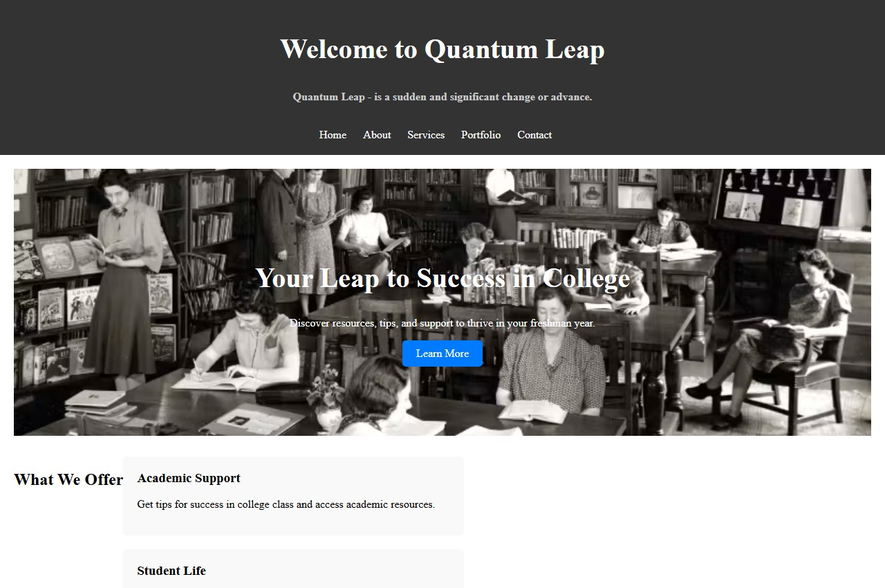
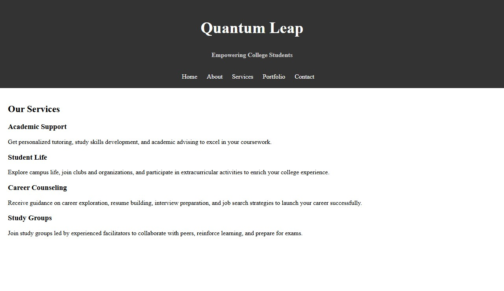
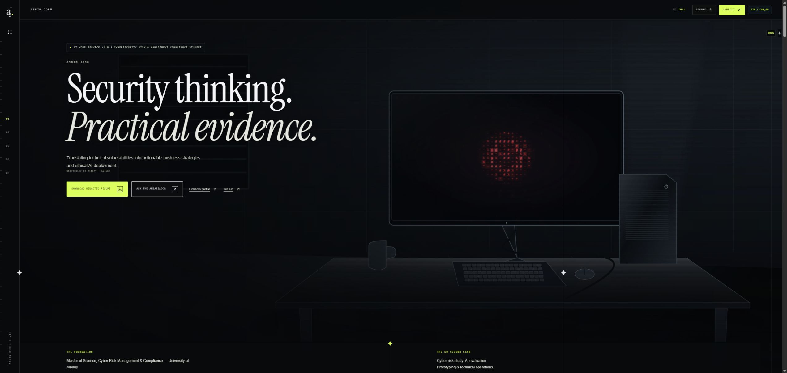
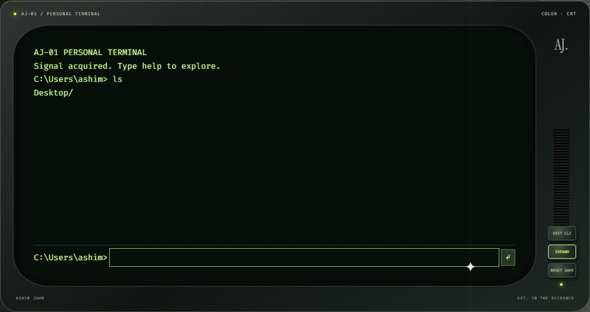
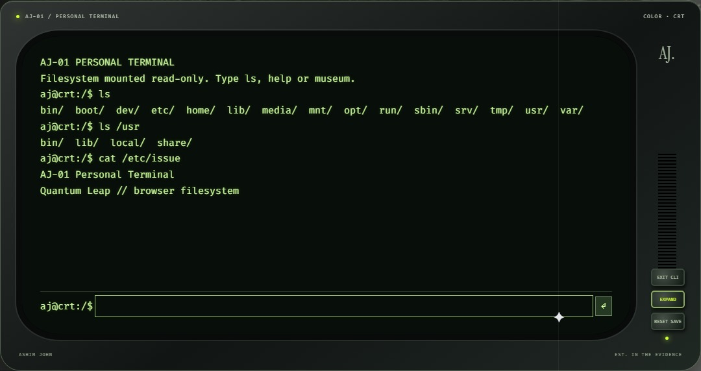
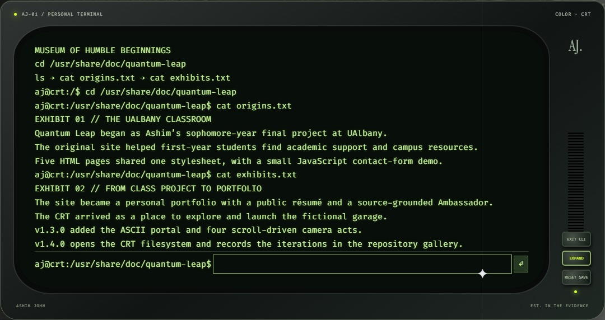

# Ashim John visual resume v1.0.15

Ashim John's visual resume, grounded exclusively in his candidate-supplied canonical LinkedIn specification. Next.js and TypeScript power a full-viewport, four-camera surveillance visual simulation, a sandboxed retro CRT game, and a Virtual Ambassador restricted to approved excerpts.

## Current status

| Item | Status |
| --- | --- |
| Camera study | Four woven acts in one scroll timeline with native color, tracked overlays, three modes and direct act jumps. |
| Local security checks | Static analysis, dependency audit, credential checks, configuration and production HTTP tests. |
| Grounded Virtual Ambassador | 283 API regressions; deterministic pre/post checks; optional server model |
| CRT filesystem and museum | FHS-inspired root, readable exhibits, and an on-demand sandboxed garage |
| Claim Audit | 223 field-to-source rows; LinkedIn-only career authority; GitHub authorized as public contact only |
| Redacted Public PDF | Three regenerated and visually reviewed pages; LinkedIn facts and public GitHub link |
| Replit Core Packaging | Root-level ZIP with checksum and manifest for each approved release. |

## How this repository is used

The private application repository follows the evidence-first documentation and scoped conventional commits of [cybr-projects](https://github.com/ashimcode/cybr-projects). Local source and GitHub remain authoritative. Career facts, approved answers and the public PDF derive from `src/data/verifiedSources.ts`. The current inventory is exactly six roles, three education entries, five certifications, three projects and five top skills. GitHub is a candidate-authorized navigation/contact link, never evidence for an additional career claim.

Historical submission packets and version tags remain historical records; use the current claim audit for current content. Future claims require the source and privacy checks in CONTRIBUTING.md. No personal phone, street address or personal email belongs in public assets.

## Quick start and verification

Use Node 24.22.2 or newer on the Node 24 LTS line and Python 3.11+. CI reads the pinned Node version from `.nvmrc` and uses Python 3.12.

```sh
npm ci
python -m pip install pypdf==6.21.4
npm run dev
# Stop the preview server before building in the same checkout:
npm run typecheck
npm run build
npm run verify
npm run verify:submission
npx playwright install chromium webkit
npm run verify:browser
npm run verify:baseline
npm run start
```

The grounding run scans source, public assets, generated client bundles and PDF text/metadata. It also runs the five local security checks. Run `npm run verify:security` after a production build to run those checks independently. See BROWSER_TESTING.md for browser coverage and evidence limits. All 33 scanner boundary cases remain enforced. No model credentials are required for verification; provider calls are mocked. Optional server Secrets use OPENAI_API_KEY or the managed Replit credential pair. See SECURITY.md for retention and per-process rate-limit boundaries.

To rebuild the public PDF, install reportlab, pypdf and pypdfium2 in your Python environment, then run `npm run resume` and `python scripts/build_resume.py`. Review the three rendered pages under ignored `.qa/resume-render/`.

## Surveillance visual simulation

An original 4K desk plate remains stationary at the top while a separate red ASCII orb animates. The first 18% of scroll zooms into the monitor, fills the viewport with crimson glyphs, then opens a circular aperture. Woven acts occupy 18–38%, 38–58%, 58–79%, and 79–100%. Direct camera controls jump to 18%, 40%, 60%, and 81%.

The 192-frame bank contains paired 1920×1080 scrub images and exact matching 3840×2160 resting images, WebP quality 92. The first two acts retain color; the last two are monochrome. The original SOC master is 1080p and is upscaled, not newly captured 4K detail. The other masters are native 4K H.264. Fourteen-frame optical dissolves bridge acts. The desktop cache holds at most 12 decoded HD frames and two 4K plates; touch devices hold six HD frames and one plate. Compressed HD look-ahead is capped at 48 entries. Requests are local assets, and the large complete release archive is never downloaded by the page.

Rebuild media with `python scripts/build-woven-surveillance-reel.py --masters <master-folder>` using FFmpeg, FFprobe, Pillow, NumPy and OpenCV. `node scripts/build-portal-desk.mjs` regenerates the authored desk illustration. Runtime dependencies are unchanged. Native-DPR room/CV backing stores are bounded by a 3840×2160 pixel budget (rotated for portrait); the glyph effect uses a separate CSS-resolution buffer capped at 1920 pixels on its long edge. When scrolling settles, the same exact frame sharpens to 4K; failure keeps that HD frame instead of jumping to an anchor. Pointer inspection stays interactive. Animation uses requestAnimationFrame and targets 60fps; actual throughput depends on the browser and hardware.

HYBRID_CV, YOLO_BOXES and SLAM_KEYPOINTS select simulation layers. Named subjects are hand-marked and interpolated within visible ranges. The motion study also measures luminance changes and gradient keypoints on the displayed frame. Motion percentages describe pixel evidence. The system performs no model inference, biometric identification, redaction, or audit. Reduced Motion uses stills, OFF hides the overlays, and failed frame requests expose a retry action.

## Custom analytics

Six custom events send fixed labels through the optional Replit Umami tracker. Résumé downloads use a location label, profile links use a platform label, Ambassador events use submission mode and outcome, clearing sends no data, and FX sends the effective mode. The application excludes chat text, full URLs and personal data from custom event data. Actions work with the tracker absent or failing. Run `npm run verify:analytics` for the event contract.

## Explore the CRT

Open **>_ CLI** on the footer CRT. Start with these commands:

```text
ls /
tree /usr/share/doc/quantum-leap
cat /usr/share/doc/quantum-leap/origins.txt
cd /opt/carmechanicos
start game
```

`museum` points to the exhibits. The [terminal walkthrough](docs/CRT-FILESYSTEM.md) explains navigation, completion, and the original `Desktop/carmechanicos` shortcut.

The on-demand game runs in an opaque-origin srcdoc iframe. Its restrictive CSP blocks network connections/forms, and a source-window/session-validated bridge exposes only bounded internal save slots under `ql_carmechanicos_save_v1`. Reset removes only that key. EXPAND uses the modal top layer while a placeholder preserves footer geometry. COLLAPSE retains the same frame; ESC / EXIT GAME unmounts it, cancels its execution context and restores CLI focus without scrolling.

## Build journal

Quantum Leap began as Ashim's sophomore-year final project at UAlbany. The original site introduced first-year students to academic resources and campus life. The portfolio grew from that work. The [build journal](docs/BUILD-LOG.md) follows the classroom pages, the scroll-driven portfolio, and the CRT filesystem.

## Screenshot gallery

<table>
  <tr>
    <td width="50%"><a href="assets/screenshots/classroom-home.jpg"></a></td>
    <td width="50%"><a href="assets/screenshots/classroom-services.jpg"></a></td>
  </tr>
  <tr>
    <td><strong>The classroom homepage</strong><br>The first five-page site introduced resources for incoming college students.</td>
    <td><strong>The services page</strong><br>The original HTML and shared stylesheet organized student support into a dedicated page.</td>
  </tr>
  <tr>
    <td><a href="assets/screenshots/v130-portal.jpg"></a></td>
    <td><a href="assets/screenshots/v130-crt-desktop.jpg"></a></td>
  </tr>
  <tr>
    <td><strong>The portfolio takes shape</strong><br>v1.0.9 introduced the desk, the red ASCII portal, and four camera acts.</td>
    <td><strong>The first CRT shell</strong><br>The Desktop folder provided a route into the hidden garage.</td>
  </tr>
  <tr>
    <td><a href="assets/screenshots/v140-crt-root.jpg"></a></td>
    <td><a href="assets/screenshots/v140-crt-museum.jpg"></a></td>
  </tr>
  <tr>
    <td><strong>A filesystem to explore</strong><br>The CRT now opens at / and supports browsing, completion, and reading.</td>
    <td><strong>Museum of Humble Beginnings</strong><br>Visitors can read how the class project became the current portfolio.</td>
  </tr>
</table>

## Release and deployment

Open the current build on [Quantum Leap](https://quantum-leap-interactive.replit.app/).

The [release history](docs/RELEASE-VERSION-MAP.md) counts release milestones. Patch 20 rolls over to patch 0 of the next minor version. Freeze refuses skipped versions and existing tags.

```sh
npm run release:next --silent
# Bump to the version printed above.
npm version X.Y.Z --no-git-tag-version
npm run release:freeze
npm run verify:baseline
python scripts/export-replit.py --output ../quantum-leap-vX.Y.Z-replit.zip
```

The exporter recursively includes public assets and explicitly requires all four surveillance feeds and posters. It excludes dependencies, build output, Git/QA files, archives and secrets. Only the approved public PDF is included. A checksum and per-entry manifest accompany the ZIP.

Do not blindly overwrite a running Replit workspace: preserve its documented port-5000 scripts/workflows and development preview overlays when applying the update. Canonical local scripts use port 3000. Keep platform-managed Node and the corrected empty `replit.nix` dependency set; never reintroduce the conflicting OpenSSL library-path override. No Replit Agent credits are needed. A permanent host/custom domain remains a separate decision.
